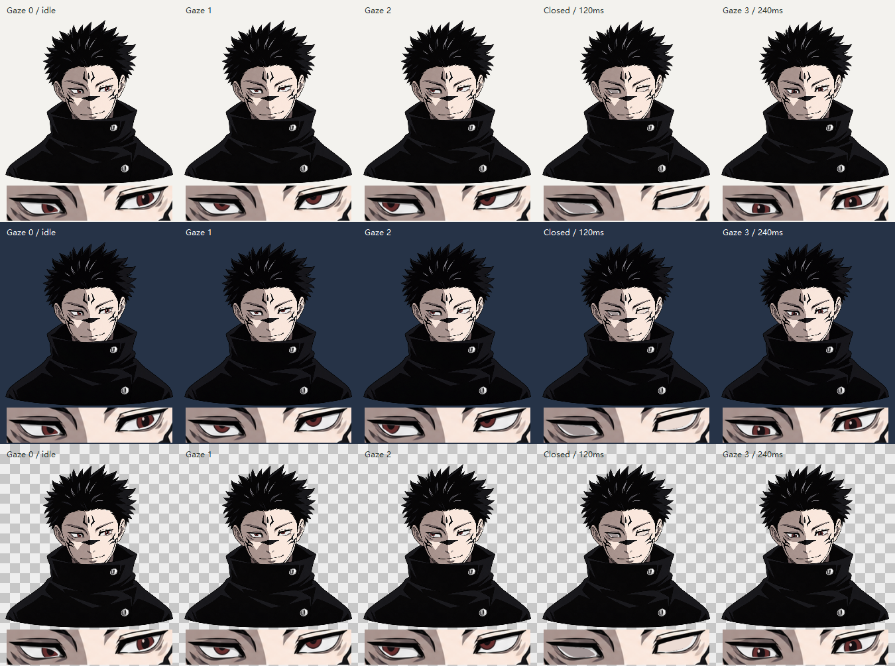

# #13 验证记录

日期：2026-10-24（Asia/Shanghai）。环境：实际 Windows x64 桌面，Python 3.14.4、PySide6/Qt 6.12.0。基准：原型提交 `9eef9e2418d536fe6a5b71235841ae98da64329c`，结合 #12 最终规格。

## 自动行为验证

经统一应用入口输入点击与虚拟时间；不访问 Qt 私有成员，不依赖 UI 自动化调用耗时。

- 首次启动无输入保持静止；单击普通阶段以固定 3× 向前运动并停留。
- 视线 2 终点保持且眼皮不动，额外左移仅作用于角色右眼（画面左侧），另一眼不追加修正。
- 单独点击进入视线 3：119ms 前保持进入前视线，120ms 闭合时直接换到终点，240ms 睁眼停留；无第三段中间转眼，停留不再眨眼。
- 末段回起点停留；下轮可再次触发眨眼。
- 原型直接生成的 7 组操作记录验证普通轨迹、局部修正平滑进入/撤回、动作中目标覆盖、闭眼前后再点击、跨周期连点、大量点击不积压多轮。
- 大步长与 1ms 小步长推进得到同一眨眼终态。

最终执行结果：`python -m pytest -q`：10 passed；`python -m mypy src`：5 个源码文件无错误；`python -m pip check`：无损坏依赖；`git diff 6294006...HEAD --check`：通过。双轴审查见 [review.md](review.md)。

## 原生 Windows 观察

使用 computer-use 的原生 Windows 窗口截图及点击接口操作实际 `pythonw -m sukuna_pet`，并观察 `tools/visual_check.py --show` 的原生 Qt 窗口。

- 实际角色窗口无边框、透明半身，首次显示静止；单击后眼球向原型对应方向移动，到视线 1、视线 2 后保持，视线 2 不自行眨眼。
- 第三次单独点击后眨眼并在视线 3 睁眼保持。眼白路径、眼球尺寸/颜色、眼皮几何与原型对应；整个半身没有附加平移或身体摆动。
- 第四次点击回到起点并继续保持；从起点进行原生双击会推进到视线 2 并停留，第二次点击未被 Qt 的双击事件吞掉。
- `qt-contact-sheet.png` 使用生产播放入口和生产绘制器，在 Qt 中渲染浅色、深色、棋盘背景的视线 0/1/2、120ms 闭眼和240ms 睁眼帧，附眼部放大。已在真实 Windows Qt 窗口和导出图中检查：未见明显白色边框、重复眼球、眼球溢出眼框或背景穿帮；深色背景下黑发与背景的对比低属于原重绘配色。
- 图是渲染对照图，不是动画录屏，也不作为 Windows 跨应用输入穿透的证据。实际 UI 操作耗时不用于宣称精确动画时长；120/240ms 与速度由虚拟时间验证。

## 资源与交付边界

PNG 从固定原型提交按字节复制，SHA-256 与原清单一致。运行入口只读取包内素材。原视频和参考程序均未读取、修改或作为运行依赖。

`pip wheel . --no-deps` 已成功构建 wheel；使用 `python -I` 从 wheel 本身导入应用和绘制器，成功读取随包 1419×1108 PNG，SHA-256 仍一致。此检查确认资源随 Python 包收集，不代表 #17 的独立 Windows 安装包已完成。

本票不验收 #14 的持续模式与设置记忆、#15 的跨应用输入穿透和完整拖动规则、#16 的多屏/DPI 工作区约束、#17 的安装及卸载。它们仍由各自工单跟踪。

