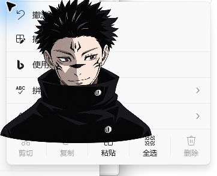

# #15 原生拖动、透明处穿透与置顶

日期：2026-10-24（Asia/Shanghai）。Windows x64、Python 3.14.4、PySide6/Qt 6.12.0，Qt 平台 `windows`，本次屏幕设备像素比 1.0，平台拖动距离为 10 个逻辑像素。规格为 #15 和父规格 #12，审查基点由用户确认是 `e4df517`。

## 应用输入边界

沿用父规格中已确认的应用级交互入口，扩展 `PetApplication` 接收左键按下、移动、释放和输入取消。Qt 适配器传递平台拖动距离和逻辑全局坐标，并执行返回的窗口移动；普通释放仍通过统一 `click()` 推进。测试只观察公开 `view` 和移动结果，不访问 Qt 私有状态。

TDD 首项先失败（缺少 `pointer_press`），实现后通过。8 项行为检查覆盖：拖动及释放不推进、下一次普通点击继续工作；平台阈值 4/10/20；拖回起点不误点击；只有远距离释放而无移动事件；小幅抖动只点击一次及忽略无按下的释放；捕获中断取消；阶段播放中拖动不覆盖目标。距离使用 Qt 平台设置和设备无关坐标，没有沿用原型固定 6px。

命中区域来自与实际绘制相同的裁剪、平滑缩放后的非零 alpha 轮廓，所有半透明像素保留。`QWidget.setMask(QRegion)` 设置实际窗口区域；不以 `HTTRANSPARENT` 的同线程限制或整窗鼠标忽略代替可见处交互。眼睛在不透明脸部内，轮廓固定。

Qt 依据：[窗口掩码](https://doc.qt.io/qt-6/qwidget.html#setMask)、[平台拖动距离](https://doc.qt.io/qt-6/qstylehints.html#startDragDistance-prop)、[设备无关坐标](https://doc.qt.io/qt-6/highdpi.html)。

## 真实 Windows 应用验收

使用 `computer-use` 技能的 `@oai/sky` / `node_repl` 注入系统鼠标，在生产 `PetWindow` 与独立进程 Windows 记事本中验收，未用网页按钮或 Qt 合成鼠标事件证明穿透。观察工具 `tools/verify_pointer_native.py` 注入生产应用对象，只读取公开播放状态、窗口几何和原生置顶标志，日志见 [native-trace.jsonl](native-trace.jsonl)。该工具不读写用户模式设置。

1. 将记事本空白测试页移到角色下方并使记事本前置；角色仍覆盖其编辑区显示，日志记录非桌宠前台时 `native_topmost=true`。截图中可见的记事本菜单与角色重叠，也证明普通应用前置后角色仍在其上方。
2. 角色窗口左上透明角：当角色位置为 `(1368,598)` 时，在记事本客户区 `(746,432)`，对应屏幕 `(1378,608)`、角色局部 `(10,10)` 单击，未触发阶段推进；记事本随后可输入测试句 `PASS: native transparent input reaches Notepad.`。
3. 在相同透明角注入系统右键，出现记事本的撤销/拼写/剪切等编辑菜单，角色仍显示在该菜单上。这是下方真实 Windows 进程收到输入的直接证据，见下图。
4. 在角色局部 `(120,120)` 单击，公开状态从阶段 0 经眼动到阶段 1，最终 `holding=true`，两眼中心为 `(639,467)`、`(798,456)`。
5. 从角色局部 `(120,120)` 拖到 `(60,80)`，窗口由 `(1368,598)` 移至 `(1308,558)`；释放后阶段仍为 1，两眼中心和停留状态均不变。拖动在透明背景的窗口范围内进行，鼠标捕获保持有效。
6. 在可见角色右键，打开“点击跳动 / 持续跳动 / 退出”真实菜单，仍勾选点击跳动，阶段保持 1。系统鼠标点击“退出”后观察工具返回码 0。

另外重跑 `tools/verify_modes_native.py`，三个真实 Windows/Qt 进程均返回 0，模式选择、保存、重启恢复及退出没有因命中区域改变而回归。该辅助检查使用 Qt 输入；上述跨应用检查使用系统鼠标。

## 验证范围

类型检查通过。最终完整测试套件结果及双轴审查结论见 [review.md](review.md)。界面调用时间不作为动画时序证据；精确眼动时序仍由原有虚拟时间夹具验证。

本机仅对设备像素比 1.0 的真实桌面做了跨应用验证；其他阈值由应用级测试覆盖，不能据此宣称已完成真实混合 DPI/多屏验收。跨屏、任务栏可用区域和边缘约束属于 #16，独立安装及卸载属于 #17。本票不增加位置记忆或缩放设置。
