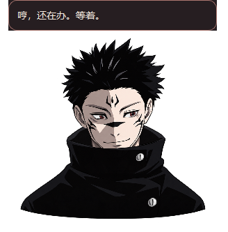

# DeepSeek 参考文件桥运行验证

日期：2026-10-26（Asia/Shanghai）。任务：[运行 dsh-pet 参考文件桥并接通 DeepSeek 桌宠联动](https://github.com/xyd-0811/skip-pet/issues/38)。用户已明确授权从仅规划转入“先让参考方案跑起来，再根据实际差距补齐”。完整现态要求继续作为后续验收目标。

## 实现

- 自有零依赖宿主插件 `@sukuna-pet/dsh-bridge`，按 dsh-pet 的 JSONL / pnpm 安装机制实现，使用独立数据目录，不依赖参考仓库或参考发行物运行。
- 桌宠后台读取观察快照与增量结束事件，按根轮次归并；原生任务联动模式和输入透明的独立气泡窗口。任务停止后自然收尾，保留手动点击和原有持续模式。
- 读取不会把未知或普通审批审计对当作已知人工等待；有未知子活动时不将整轮归为等待。部分观察与完整宿主现态分开。

## 已执行的验证

| 项目 | 结果与边界 |
| --- | --- |
| 完整 Python / Qt 回归 | `pytest -q --basetemp=.scratch/issue38-complete --junitxml=.scratch/issue38-complete.xml`：199 passed，94.86 秒 |
| 类型检查 | `mypy src`：9 个源码文件通过 |
| 实际 JS 插件测试 | `node tests/bridge_harness.mjs .scratch/issue38-bridge-complete`：写盘、独立健康、问题/并发工具切换、完成、脱敏、释放监听均通过；宿主由测试替身提供，非实机并发证明 |
| 隔离 profile 安装与移除 | 真实 pnpm 离线安装及移除通过；保留原有 bundles，产生备份。首次发现 pnpm 11 的 remove 不接受 add 的 flags，已修正并复测 |
| 实际 desktop profile | 正常安装到既有 desktop profile。安装前备份目录 `sukuna-bridge-backup-20261026-104307-873713`；只添加自己的依赖与 bundle，未改安装目录或其他插件 |
| 普通 Harness 桌面启动 | 从原安装路径启动，实际宿主子进程发布本项目快照；健康计数观察到 29、244、722，生命周期 active，范围 observed |
| 真人实际短任务 | 用户在新聊天发送无工具/无文件修改的短请求，并回复“已测试”。自有桥记录原生 running（known=true）→ turn/end(completed) → idle。未读取宿主真实会话日志或聊天正文 |
| 实际桌宠预览 | 通过 `tools/run_reference_pet.py` 启动。实际 Qt 窗口标题“宿傩桌宠 · DeepSeek 接入预览”，进程 Responding=true；连接实际用户桥目录，空闲汇总为 0，启动 stderr 为空 |
| 气泡与播放 | Qt 专项验证运行/等待/隐藏、输入穿透标志、顶部避让、负坐标工作区限制、任务模式收尾与手动点击；原有手感回归由完整测试覆盖 |

窗口操作工具的 kernel assets 初始化失败，因此实际短任务由用户手动发送。该任务发生时，持续运行的桌宠预览尚未启动：已证明的是“真实任务→真实桥文件”，以及独立的“桥消费→Qt 气泡/播放”测试；不把两者合称为已经现场看完的同一次端到端动画。预览现在已连接实际桥，后续正常任务可继续现场检查。

下面是受控运行状态下直接抓取自有 Qt 窗口的视觉检查图，不是该真人任务当时的截图：

## 后续差距

普通审批的权威人工等待识别、插件中途加载时完整恢复、legacy/嵌套/timed 问题、真实子代理并行、原生多屏/混合 DPI、重载与安装维护尚未全部实测。自动路径维护、产品安装菜单及新版 Setup 尚未完成。Codex 未接入。

本轮完成参考最小接入，不关闭[完整现态入口研究](https://github.com/xyd-0811/skip-pet/issues/37)，不宣称完整协议或全部等待门槛通过。后续以实际差距推进，不再以先获得上游回复作为参考开发的前提。

运行、刷新和移除命令见[参考文件桥运行版](../../reference-bridge.md)。自有桥目录为当前用户 `%LOCALAPPDATA%/sukuna-pet/bridge/dsh`，原有桌宠偏好和旧版安装包未覆盖。
