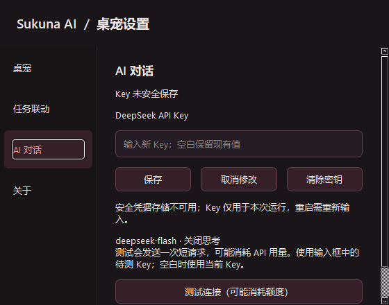
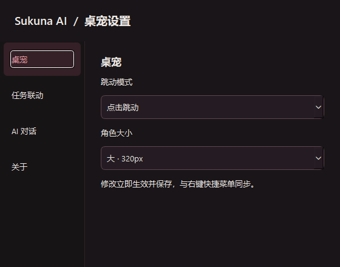

# #49 桌宠设置与 AI 接入配置

日期：2026-10-27（Asia/Shanghai）。本票交付源码实现及行为验证；完整聊天、视觉集成、冻结安装包和作者试聊由 #50–#53 承接。本次没有覆盖已有安装包、发起真实计费请求或发布版本。

## 实现

- 角色右键“桌宠设置”打开唯一原生窗口，导航/内容采用 #45 确认的黑红布局和四组设置。重开激活同一窗口，关闭/Escape 丢弃草稿并保留桌宠。
- 模式和大小复用 PetWindow 的操作入口，保存失败恢复控件，菜单重开读取同一状态。mode.json 保留未知顶层及 dsh_bridge 内字段。任务联动状态、启停、检查修复沿用既有 BridgeController 的预检、安装确认、忙碌控制及通知；未扩大宿主范围。
- Key 存在当前 Windows 用户 Credential Manager 的独立条目，普通偏好不含 Key。后台不可用时仅内存降级；删除失败清空当前内存和草稿，明确报告安全存储残留风险，当前进程不重新读取旧值。输入清空也重置撤销历史。
- 连接测试独立于存储，仅主动点击并确认可能计费后发送一次短请求，使用待测草稿或当前 Key。保存不测试，测试不保存、不写聊天历史、不自动重发；状态不冒充持续在线。HTTP 重定向被拒绝，服务端响应正文和异常内容不会回显。
- 关于从源码或随冻结包嵌入的 pyproject.toml 读取版本，轮式安装读取分发元数据；不依赖开发环境可能过期的 editable 版本。必要署名及 MIT 全文随包保留。

## 官方契约与参考

实施时重新核对[官方 Chat Completions 契约](https://api-docs.deepseek.com/api/create-chat-completion/)和[思考模式文档](https://api-docs.deepseek.com/guides/thinking_mode/)。与 #48 规格无差异：`POST https://api.deepseek.com/chat/completions`，Bearer，`deepseek-flash`，`thinking: {type: disabled}`。主动测试为非流式单条短输入、输出上限 8 tokens；不用于证明流式或角色口吻。

固定参考仓库提交仍为 `34d810b1eadd98d00e7cb9b3b51428a45b5bf03e`，工作树干净。对照了 `pet/chat/models.py:SecretStore`、`pet/chat/providers.py:test_connection/thinking_payload`、`pet/chat/widgets.py` 和 `pet/agent_link/__init__.py:AgentLinkManager.set_enabled`。

采用同样的凭据隔离/不可用降级、显式单次测试和后台安装思路。本项目直接适配 Windows CredReadW/CredWriteW/CredDeleteW，避免后端选择或隐式明文降级；错误仅给固定分类文本，并额外拒绝重定向。设置维护沿用本项目已实现的 BridgeController。没有复制上游多服务商、联网、记忆或个人数据。

## 超时与关闭

HTTP 操作设置 10 秒 socket 等待超时；响应最多 64 KiB，逐块检查 20 秒接收预算。socket 等待和接收预算不是涵盖 DNS 等阶段的整轮硬截止。GUI 另有 30 秒等待上限，超时立即恢复可测试状态并使旧请求身份失效。

关闭、取消草稿、保存或清除 Key 都使当前测试回调失效；旧结果不污染重开的窗口或新请求。后台使用 daemon Python 线程，Qt 对象销毁后安全丢弃结果，不存在运行中 QThread 被销毁的问题。关窗和 GUI 超时不保证服务端停止计费；已经发出的请求持有启动时的凭据快照，应用退出不会等待 daemon 线程。

## 验证证据

- [类型检查](mypy.txt)：16 个运行源码文件通过。
- [完整测试输出](pytest.txt)及 [JUnit 结果](pytest.xml)：**299 passed，245.23 秒**。基于暂存源码导出的隔离目录 `.scratch/issue49/final-source/` 运行，排除工作区原有未提交代码。
- 新增公共行为验证：菜单/设置同步及保存失败回退、未知字段、窗口复用及 Escape、Key 保存/取消/空白/草稿/撤销/清除失败/降级、Windows 随机独立条目的跨进程读写删除；HTTP 参数、错误分类与脱敏、不重试、不跟随重定向、停滞超时；GUI 等待上限、对象销毁及真实待返回 HTTP 在关窗重开后的迟到结果；桥接预检确认、忙碌与失败提示。
- Windows 凭据和 HTTP 测试在允许相应系统访问的进程中运行。凭据验证只用随机测试条目和虚构值，finally 删除；接口使用本机测试服务器，不使用真实 Key。
- [双轴代码审查](review.md)：Standards / Spec 分别报告，无剩余实现问题。
- 原生 Qt 截图覆盖 100%、125%、150%，560×440 最小窗口内容通过纵向滚动可达；无横向裁切。100% / 150% 截图随本记录保存，125% 在本地 `.scratch/issue49/scale125/`。截图通过 [capture_settings.py](capture_settings.py) 生成，使用不可用凭据替身，不读取个人 Key。

复现完整回归：在项目根目录运行当前环境 Python，`-m pytest .scratch/issue49/final-source/tests -c .scratch/issue49/final-source/pyproject.toml -q --tb=short --basetemp .scratch/issue49/final-suite`。新的复验应换一个不存在的 basetemp 目录。

## 实测边界

未使用真实 DeepSeek Key 发起计费生成；官方接口只完成契约核对，本机服务验证请求和回调。当前凭据验证是源码 Python 跨进程，未冒充冻结安装版验证。截图是原生 Qt 渲染，不代表已完成混合多屏 DPI、全部桌面交互或 #52 的完整视觉验收。#53 仍需冻结包凭据/TLS/目录验证及作者亲自试聊。

## 截图

