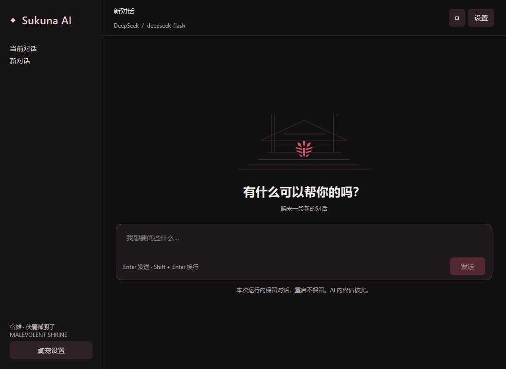
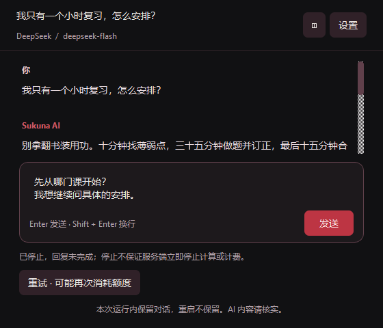

# #50 原生连续聊天、停止与重试

2026-10-27（Asia/Shanghai）。交付范围：#50 的源码实现和可控行为验证。跨重启记录/多会话由 #51 承接，完整视觉与桌面集成由 #52 承接，冻结安装版及作者真实试聊由 #53 承接。本次没有使用真实 DeepSeek Key 发起计费请求，没有替换已有安装包或发布版本。

## 实现与边界

- 角色右键“AI 对话”打开唯一 PySide6 独立窗口；重复打开激活同一窗口，关闭保留当前运行内会话及草稿，桌宠继续运行。退出桌宠关闭聊天、取消当前请求并释放凭据。
- 采用 #45 黑红原型的基本结构：侧栏、神龛线稿及标记、空态欢迎/约 110px 输入区、聊天消息滚动和底部输入；窄于 800px 自动收起侧栏，Enter/Shift+Enter 与中文输入法行为分别验证。当前侧栏只显示本次运行中的会话，没有假造尚未接入的会话管理按钮。
- 作者 #46 正文逐字保留，补充要求和版本 `sukuna-2026-10-27-v1` 存于冻结的 AuthorPrompt；ChatSession 保存稳定 ID、完整消息、时间元数据、请求关联和状态。时间元数据不注入请求。可恢复快照对象为 #51 的仓储接入留出明确边界；当前没有声称已落盘。
- 请求历史复现固定上游 trim_history：从最近向前选择，最多 40 条、24,000 字符，只对单条超长的最新历史取尾部，遇到旧消息超预算即停止；不修改完整会话。system 和本轮问题另外加入。
- 请求与模型固定，显式关闭思考；只接收 content，reasoning 不展示、不记录、不回传。SSE 在完整事件后解码 UTF-8，处理 CRLF/LF、注释/空心跳、usage 事件；必须同时收到 `finish_reason=stop` 和 `[DONE]` 才算完成。EOF、length 或其他结束原因不会冒充成功；无正文有单独提示。
- 请求只发送一次；按固定文字区分 Key、余额、限流、繁忙、网络、超时、空正文和断流，不回显服务端错误正文或异常字符串。拒绝 HTTP 重定向，避免将 Authorization 转发至其他地址。
- 停止/关窗将当前回复标记未完成，立即使请求身份失效；每次回调校验会话 ID 与请求 ID。重试替换最后未完成回复，原问题保留一次，被替换内容不进入请求；普通追问可以沿用部分正文。设置修复后仍须手动发送，重试控件明确提示可能再次计费。

## 超时与取消清理

HTTP socket 等待上限 10 秒；后台从建立请求开始计算 180 秒接收预算，每次读取前检查。socket 超时与接收预算均不冒充涵盖 DNS 等系统阶段的整轮硬截止。GUI 另设 180 秒等待上限，即使底层尚未退出也立即恢复操作、标记未完成并拒收旧事件。

UI 停止仅设置线程安全取消信号，绝不在 GUI 中 close 等待中的 HTTPResponse 或 join 网络线程。读取线程在下次读返回、socket 超时或异常时观察取消并通过上下文管理关闭响应；凭据快照及请求临时数据在线程退出时释放。已发出的服务商计算/计费不能保证撤回。

后台为 Python daemon 线程，无运行中 QThread 被销毁风险；Qt owner 销毁后发送信号失败会安全丢弃。`busy` 仅表示界面当前生成，`running_workers` 反映实际尚未退出的线程；最多允许 4 个待清理请求，达到上限提示稍后手动操作，避免连续停止/重试堆积无限线程。进程退出不等待 daemon 网络线程。

## 参考与契约

固定 dsh-pet 仍为 `34d810b1eadd98d00e7cb9b3b51428a45b5bf03e`，参考工作树干净。阅读了 `pet/chat/prompt.py:PromptBuilder.trim_history/build_messages`、`providers.py:SSEParser/_stream_answer`、`service.py:ChatService/_Worker` 和 `widgets.py` 的输入/消息/生命周期实现。

采用其历史选择、请求身份和取消分离机制；有意排除多服务商、默认友善人设、场景、时间、记忆和推理回传。本项目用 Python daemon 线程避免 Qt 线程对象销毁崩溃，并添加独立 GUI 上限、严格结束校验、固定脱敏错误与拒绝重定向。历史选择的上游署名与完整 MIT 文本保留在 `chat_session.py` 和 `packaging/licenses/dsh-pet-MIT.txt`，现有构建会随包复制许可证目录。

开发时重新核对[官方 Chat Completions](https://api-docs.deepseek.com/api/create-chat-completion/)及[错误码](https://api-docs.deepseek.com/quick_start/error_codes/)，与本票固定 endpoint/model/thinking/SSE 契约一致；没有静默替换模型。

## 验证

TDD 边界由用户确认：可控 HTTP/SSE、聊天控制器、原生 Qt 窗口。按切片先观察失败再实现：角色/上下文 → 流式请求 → 停止/重试 → 窗口/菜单 → 窄窗口修复。单文件/定向测试与类型检查在实现期间反复运行，最终增加 Key 格式及真实 HTTP 分块截断验证。

- [完整测试输出](pytest.txt) / [JUnit](pytest.xml)：**335 passed，270.38 秒**，其中新增聊天行为 36 项。
- [类型检查](mypy.txt)：**20 个源码文件通过**。
- 完整回归只运行一次，使用 `git archive` 导出的 `.scratch/issue50/final-source/` 候选源码，排除工作区原有未提交代码。运行候选 `4dbf39b7c773e3cc49546fcc6c874815e137a9f1`；`src/` 树 `e1a294e01f3d62ce619aedc773c27959d7e11974`，`tests/` 树 `bad29f30481325487102f001a036e96b22463e01`。最终补入文档和证据时保持两个代码树不变。
- 通过 gh 重新读取 #46 确认评论，程序比对 `AUTHOR_PROMPT.body` 与 text 代码块完全相同。
- [双轴代码审查](review.md)保留 Standards 和 Spec 两个独立方向的结果。

复现：在根目录使用项目 Python 执行 `-m pytest .scratch/issue50/final-source/tests -c .scratch/issue50/final-source/pyproject.toml -q --tb=short --basetemp <新的测试临时目录>`。临时目录每次选择不存在的新路径。源码快照由上述候选提交通过 git archive 导出。

HTTP 测试使用本机服务和虚构凭据；测试局部绕过系统代理，使用 HTTP chunked framing 强制逐字节读取，确保 UTF-8 与 SSE 边界测试不被 TCP 合并掩盖。覆盖错误分类、结束标记、停止/取消、实际线程退出与 GUI 停止分离、重试请求次数、凭据快照、历史边界、窗口销毁/重开、中文输入法及任务状态隔离。

截图通过 [capture_chat.py](capture_chat.py) 生成，只用内存模拟文本和不可用凭据替身，不读取个人 Key。100%/150% 分别保存空态、对话和 560×480 窄窗；125% 亦单独检查。截图中的回复是 #46 静态样例，不是模型实测结果，不能作为作者语气验收。显示缩放截图不冒充 #52 的完整视觉、多屏 DPI 或 #53 的安装版验证。

