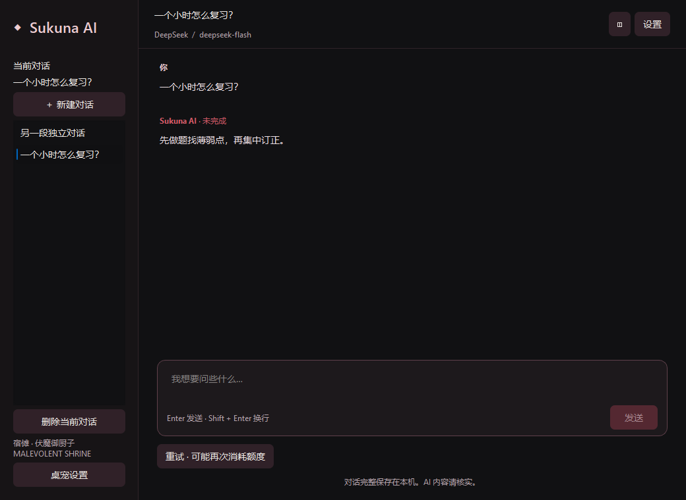
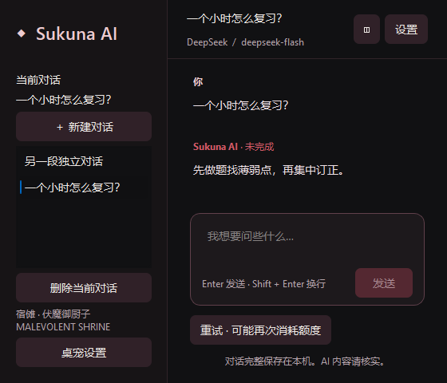

# #51 多会话与本机记录恢复

2026-10-27（Asia/Shanghai）。范围为 #51 源码实现及行为验证。最终代码候选 `efcd6c6c863f9abf2a10200d9cb45a31da66d8db`，前置 #50 已关闭。#52 完整视觉集成、#53 安装包与作者真实试聊仍由后续任务承接；本轮没有读取个人 Key、调用真实模型、修改参考程序数据或替换已有安装包。

## 实现

- 侧栏连接实际会话：新建、选择和确认删除；会话、消息使用稳定 ID，用户问题和回复保存请求关联，记录包含创建/更新时间。删除后至少保留一个可继续聊天的空会话。
- 正式入口使用本应用 `QStandardPaths.AppLocalDataLocation/chat/sessions`，每个会话独立保存 schema_version=1 的 JSON；显式测试路径隔离于个人数据。凭据不进入会话序列化。既有偏好和任务桥接不由会话仓储改写。
- 保存完整消息及创建时的作者正文、补充和版本快照；请求历史裁剪不修改本机记录。受控 v1/v2 提示词测试证明旧会话重启仍用 v1，新会话用 v2，没有新增人设编辑入口。
- 每次开始、正文增量、停止、结束及会话切换提交不可变字节快照。单一后台线程串行处理写入和删除，同一会话的排队快照合并；同目录临时文件 flush/fsync 后原子替换。GUI 不等待磁盘，不将可变 ChatSession 交给后台。
- 删除标记立即拒绝该会话的迟到保存；已在写入的旧快照结束后，串行执行删除。删除失败保留失败操作供重试，界面诚实显示尚未保存，其他会话不被删除。
- 新建/切换/关闭先停止生成，保留原会话部分正文并标未完成；会话 ID 和请求 ID 同时隔离回调。重启时将磁盘中 generating 恢复为 incomplete；保留原消息 ID、正文和时间。重试替换部分回复且原问题只保留一次，普通追问可带上未完成正文。
- 写入失败不替换最后成功文件，内容仍在界面并显示尚未保存。关闭异步等待保存，3 秒仍未完成或已失败时提供“重试保存 / 取消关闭 / 确认关闭”，提示可能丢失未写入内容。退出桌宠遵循相同关闭流程；取消时不退出、不释放仍在使用的凭据。
- 损坏记录以 UTC 时间戳创建 `.corrupt-...` 副本并报告错误，原文件保留；备份失败也保留原文件。未知版本或不可读文件保留并提示，不覆盖为空记录；其他有效会话仍可使用。

异步写盘存在最后一个尚未落盘片段的崩溃窗口。确认关闭允许带着未保存内容退出；未结束的磁盘系统调用不被强行终止，正常操作和关闭等待保持 GUI 响应。仓储由唯一聊天控制器持有，不声称跨进程并发写入协调。

## 参考与测试边界

已阅读固定 dsh-pet `34d810b1eadd98d00e7cb9b3b51428a45b5bf03e` 的 `pet/chat/session_store.py`（串行 writer、不可变快照、pending、原子替换）与 `pet/chat/widgets.py`（新建、选择、确认删除）。采用同类串行快照和请求隔离机制，本项目另行实现严格版本/字段校验、原文件保留、失败快照重试及关闭三选项。未拷贝上游仓储实现，已有历史裁剪署名与 MIT 全文保持原状；参考工作树保持干净。

用户明确确认的 TDD 边界：SessionStore 公开读写接口，以及 ChatController/ChatWindow 新建、切换、删除、重试、关闭操作；沿用可替换 provider 与临时目录。先观察仓储缺失、异常退出状态、损坏/版本校验、控制器新建、生成中删除、侧栏、关闭三选项及桌宠退出测试失败，再逐个实现。已有行为的额外故障场景按公开接口回归。

新增测试覆盖：

- 仓储：完整历史、身份/时间/提示词快照、generating 恢复、JSON/字段/重复消息/ID/未知版本、原子替换失败、重试、备份失败、目录不可读、写入延迟与删除/迟到保存交错。
- 控制器：新建/切换停止、回到旧会话也拒收旧请求、删除生成中会话不复活、重启后的提示词版本；关闭后重启再追问或重试，核对实际请求上下文和磁盘回复状态。
- 原生窗口：真实侧栏选择及删除确认、三种保存失败关闭选择、退出取消保留桌宠和凭据、慢磁盘期间 GUI 计时器仍运行、保存完成后退出；损坏、未知版本、备份失败、目录不可读的提示和原文件，以及删除失败后的界面与重试结果。

HTTP/SSE 使用回环可控服务与虚构凭据，不发送真实计费请求。沙箱阻止回环连接时，新旧网络测试都会报 network；允许本机测试服务后定向测试通过，没有放宽网络断言。

## 最终验证

- 从 Git 提交通过 `git archive` 导出 `.scratch/issue51/final-source/`，排除工作区原有未提交改动。运行候选为上述 `efcd6c6`；`src/` 树 `6d6ede8e041e3e768d539a273efa47df6b18d6e0`，`tests/` 树 `d46460b8a7362ef6370f339caeff8539210e5590`。
- [严格类型检查](mypy.txt)：22 个源码文件通过（包含构建入口）。
- [最终完整回归](pytest-recheck.txt) / [JUnit](pytest-recheck.xml)：**362 passed，263.37 秒**，包含本票新增 27 项。
- [首轮完整回归](pytest.txt) / [JUnit](pytest.xml)：361 passed / 1 failed，267.96 秒。唯一失败为既有动画冻结帧 `first_peak-320-1.png`；[该单测复跑](frame-recheck.txt)为 1 passed，[所属动画文件复跑](bounce-file-recheck.txt)为 36 passed。因该失败触发同一源码的完整复跑，最终 362 项通过。动画算法、冻结图和该测试断言没有改变；根因未确定，没有宣称已修复间歇失败。
- [双轴审查](review.md)：Standards 0 项，Spec 0 项剩余发现；补充验证后的最终候选再次核对。
- 最终证据文档提交不改变上述 src/tests 代码树。

复现：在导出的源码目录，以项目虚拟环境 Python 运行 `-m mypy src tools/build_release.py` 及 `-m pytest -q --tb=short --basetemp <新的临时目录>`。Qt 自动测试使用 offscreen，HTTP/进程夹具需要本机回环连接权限。

## Windows 原生截图

[采集脚本](capture_sessions.py)使用临时记录、合成对话和不可用凭据替身，在 Windows Qt 平台下以 QT_SCALE_FACTOR=1 / 1.25 / 1.5 运行。三组 metrics 分别记录 DPR 1 / 1.25 / 1.5：侧栏两段真实本机会话、560×480 窄窗的列表/新建/删除/发送控件可达、未保存提示，以及取消关闭后窗口保留。抽查截图无关键控件裁切。

这些是 Qt 缩放下的本机窗口验证，不冒充真实多屏混合 DPI、#52 完整视觉验收或 #53 安装版真实语气验收。截图文字为合成内容。

