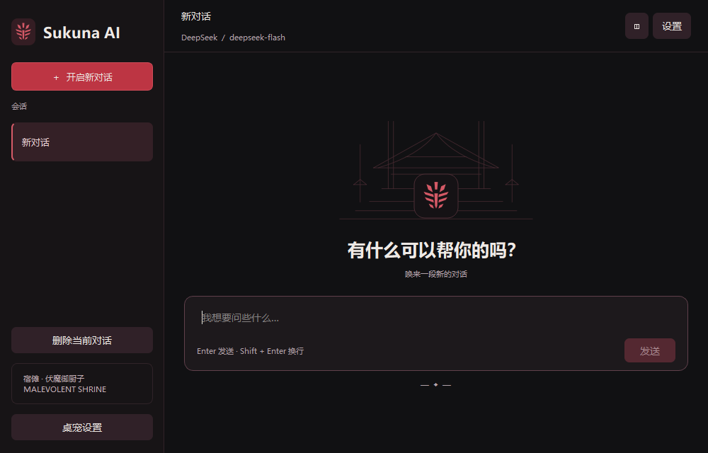
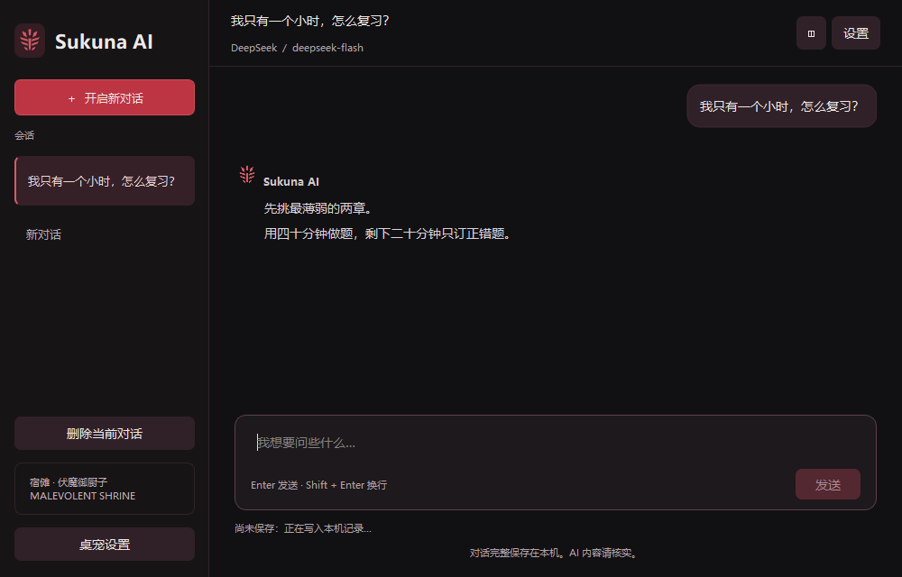
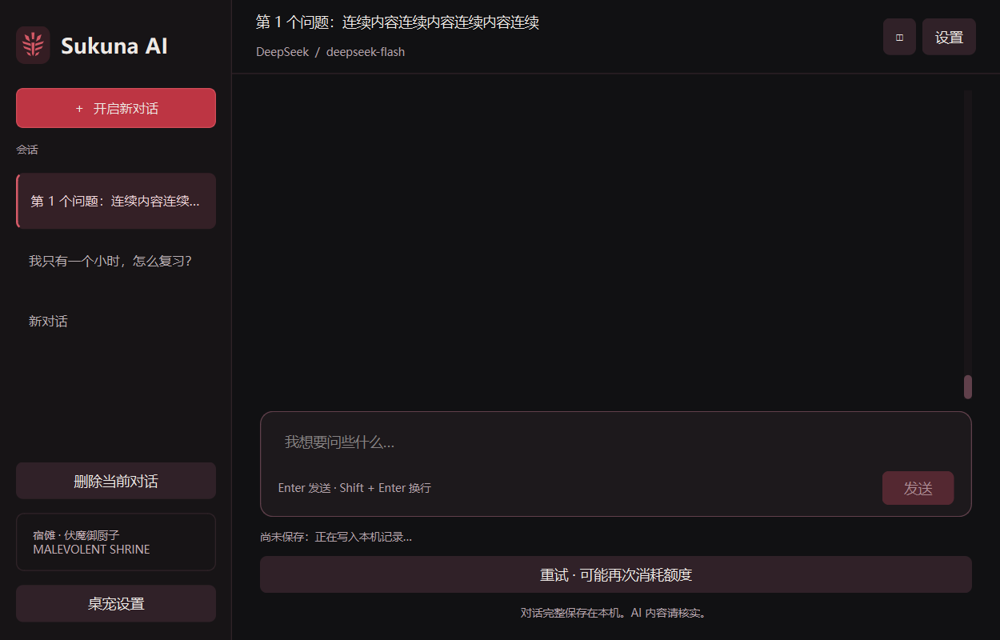
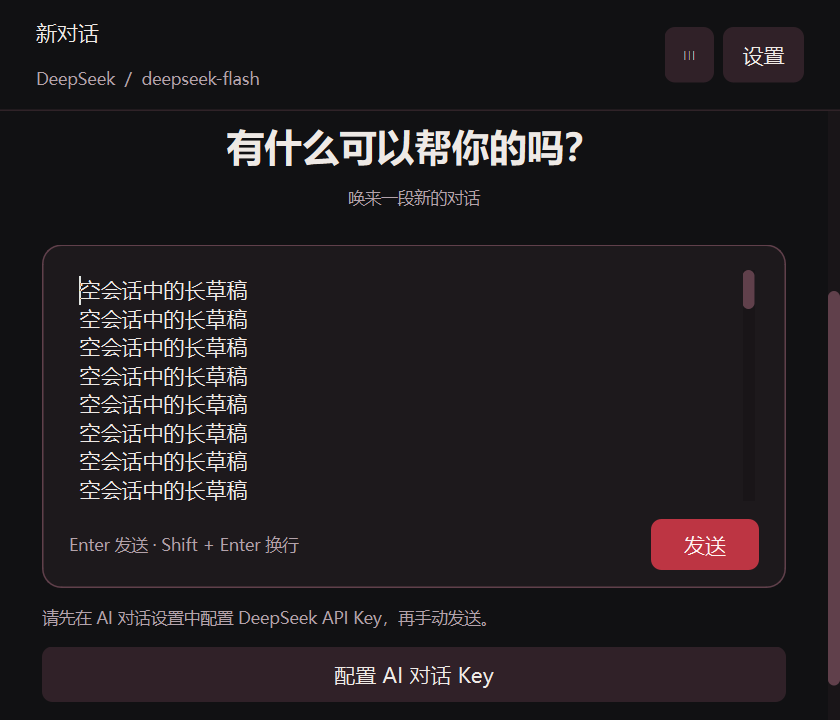
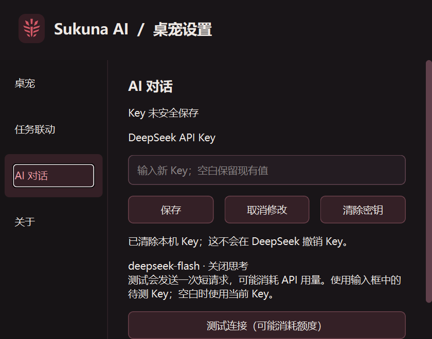

# #52 确认界面的视觉适配与桌面集成验收

2026-10-27（Asia/Shanghai）。规格为 [#52](https://github.com/xyd-0811/skip-pet/issues/52)、[#48 最终确认](https://github.com/xyd-0811/skip-pet/issues/48#issuecomment-6434830497)和 [#45 界面决议](https://github.com/xyd-0811/skip-pet/issues/45#issuecomment-6434290373)。最终代码候选 `b48fa8456452a972da9793e548d983ce90dd8f2c`。

本票完成源码版界面与桌面集成验证。安装包更新、作者自备 Key 的真实试聊和正式交付继续由 #53 承接；本轮未读取个人 Key、调用真实计费服务、改写参考桌宠数据或替换现有安装包。

## 实现

- 聊天、设置使用原生 PySide6 窗口和真实控制器、仓储、凭据及维护入口。黑红配色、宿傩标记、完整神龛线稿、字体层级、会话选中样式、背景密度与辅助文字对比度对照已确认原型。共享绘图及滚动条样式集中在 `chat_visuals.py`。
- 空会话欢迎区与约 106px 输入框紧凑居中；内容区最大 720px。多行草稿增高到 160px 后内部滚动，改变窗口宽度时重新按自动换行计算。已有消息时输入区置底，消息独立滚动。
- 用户消息按内容适宽、最大 84%，保留圆角描边；助手消息带宿傩标记。内容继续转义，图片资源按需生成，不接收外部内容作为富文本执行。顶部保留会话与实际固定模型 `deepseek-flash` 信息及窗口操作入口。
- 560×480 窄窗使用覆盖式侧栏，顶部按钮可收起；长标题不扩张窗口。内容高度超出时提供外层滚动，输入区和恢复操作可滚动到达，避免欢迎文字、草稿和发送行内部重叠。默认打开尺寸按当前屏幕工作区限制。
- 新建、切换、删除确认、停止、重试、未完成/尚未保存标记、写盘失败关闭三选项和 Key 操作继续使用 #49–#51 的正式行为。聊天仍独立于桌宠任务状态。

## 参考与测试边界

已按仓库要求核对固定 dsh-pet `34d810b1eadd98d00e7cb9b3b51428a45b5bf03e`；参考工作树保持干净。阅读 `pet/chat/widgets.py` 的空态与时间线、输入区、窄窗覆盖侧栏、滚动跟随及关闭生命周期。采用同类原生布局和窄窗策略，本项目继续复用已有会话隔离、停止和有序写盘；窗口关闭后复用同一窗口，符合本项目已确认行为。绘图依据作者确认的 HTML 资产转写，没有复制上游聊天窗口实现。

用户本轮确认沿用 #51 的 ChatWindow / SettingsWindow 公开窗口操作边界，使用临时记录、虚构凭据和可控请求。新增四项行为测试覆盖宽窗 720px/约 110px 输入区、长标题和多行草稿的窄窗可达性、缩窄后自动换行增高，以及空会话 40 行草稿与缺失 Key 提示时的内部无重叠。

TDD 记录：宽窗初始 1174px 超过上限；收紧后发现布局对齐把宽度缩为 414px，随后修正为最大宽度内展开；缩窄前后草稿高度都为 64px，补充 resize 重算后通过。审查复现空态重叠后，新测试先失败（输入下沿 409、发送行上沿 324），再通过。没有通过放宽断言掩盖重叠。

## 最终验证

最终代码通过 `git archive` 导出到 `.scratch/issue52/final-source/`，完整回归、类型检查和最终 Windows 原生回归均从导出源码执行，排除工作区原有未提交改动。`src/` 树为 `38d5acf222f465845ed67918f4f4179f3f4888d2`；`tests/` 树为 `94359ec6ae777bbdbe25d8d3611291161374be4c`。

- [严格类型检查](mypy.txt)：23 个源码文件通过，包含构建入口。
- [最终完整回归](pytest.txt) / [JUnit](pytest.xml)：**366 passed，281.21 秒**。
- [最终 Windows 原生回归](native-tests.txt) / [JUnit](native-tests.xml)：**136 passed，105.62 秒**。包含聊天/设置、会话恢复及关闭、三种模式、阶段推进/点击回弹、缩放贴边、任务气泡及桥接维护。
- [修复前完整回归](pytest-initial.txt) / [JUnit](pytest-initial.xml)：365 passed，277.86 秒。审查新增窄窗测试和修复后重新执行完整回归。
- [双轴代码审查](review.md)：Standards 0 项剩余发现，Spec 0 项剩余发现。

HTTP/SSE 与桥接测试使用本机回环和进程夹具。沙箱初跑因回环权限和 pytest 临时父目录缺失失败；修正运行环境后定向测试通过，没有改弱网络、生命周期或布局断言。

## 三档 Windows 原生截图

[采集脚本](capture_desktop.py)在 Windows Qt 平台以 `QT_SCALE_FACTOR=1 / 1.25 / 1.5` 执行，每档 16 个状态；各目录 `metrics.json` 记录环境、实际 DPR、窗口尺寸、外层滚动位置、关闭三选项、Key 保存/清除草稿和重复开关验证。使用临时会话及内存凭据替身，截图文字均为合成内容。

环境为 Windows 11 build 26200、Python 3.14.4、PySide6 6.12.0；单个 G24H1 显示器，1920×1080 物理像素。Qt DPR 分别为 1 / 1.25 / 1.5。聊天窗口采集 1000×640 与 560×480 逻辑尺寸；设置最小 560×440，通过页面滚动访问全部内容。长会话使用 162 条合成消息。

覆盖空态、多行草稿、窄窗空态长草稿与缺失 Key、真实会话列表、长对话、历史滚动、未完成回复、收起/展开侧栏、尚未保存、保存失败关闭选择，以及四组设置。截图脚本检查控件可达，另以独立测试和审查实测检查输入正文与发送行没有内部重叠。短窗超高内容明确通过外层滚动访问，侧栏覆盖展开时可用顶部按钮收起。

## 验证限制与后续

本轮验证单显示器下的 Qt 缩放与原生窗口，未覆盖真实多屏混合 DPI、跨屏切换或其他显卡/分辨率硬件。原生自动化通过 Qt 窗口事件验证交互，不宣称验证了所有物理鼠标、驱动及显示器组合。桥接维护使用隔离配置和测试进程，未重新安装个人宿主接入。AI 生成不改变桌宠任务状态的断言由真实流式回环测试覆盖。

作者真实语气、服务端计费与网络体验、安装后凭据后端和许可证随包验证仍归 #53；不把模拟消息或连接测试作为这些项目的验收。
